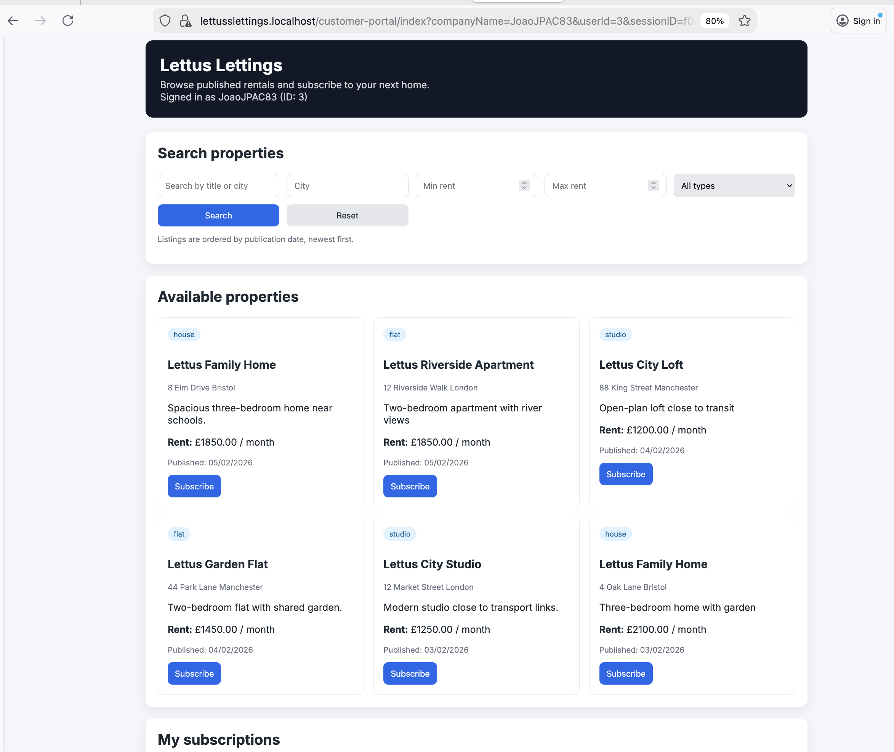

# Lettus Lettings - Rental Portal



## Overview
- Rental listings API with chronological publication ordering.
- End-user portal for browsing, searching, and subscribing to rentals.
- Local HTTPS with self-signed certs and Kubernetes + Istio for production.

## Project layout
- `cloud-lettuss-properties-api/` — API + Postgres + Nginx
- `cloud-lettuss-customer-portal/` — Rental portal UI (login, register, listings)
- `deploy/k8s/lettus/` — Kubernetes + Istio manifests

## Local development (Docker)
Start API and database:
```
cd cloud-lettuss-properties-api
docker compose up -d
```

Start portal:
```
cd ../cloud-lettuss-customer-portal
docker compose up -d
```

## Make commands
Start both stacks:
```
make all
```

Stop both stacks:
```
make all_down
```

Start only the API:
```
make lettuss_api
```

Stop only the API:
```
make lettuss_api_down
```

Start only the portal:
```
make lettuss_portal
```

Stop only the portal:
```
make lettuss_portal_down
```

Show available targets:
```
make help
```

## Local HTTPS (self-signed)
- Certs are mounted from `cloud-lettuss-properties-api/certs/`.
- For Node HTTPS in containers, set `SSL_ENABLED=true` (already in docker-compose).
- If your browser warns about the cert, trust the local cert or proceed with a warning.

## Local URLs
- API: `https://api.lettusslettings.localhost/lettus/properties`
- Portal: `https://lettusslettings.localhost/customer-portal/login`

## Test harness
Run a lightweight API harness to validate the rental endpoints:
```
cd cloud-lettuss-properties-api/node-api
ALLOW_INSECURE_TLS=true LETTUS_API_BASE_URL=https://api.lettusslettings.localhost npm run test:harness
```

Optional subscription test:
```
ALLOW_INSECURE_TLS=true LETTUS_TEST_TENANT_ID=1 npm run test:harness
```

## Production (Kubernetes + Istio)
See `deploy/k8s/lettus/README.md`.

## Core API routes
- `GET  /lettus/properties`
- `GET  /lettus/properties/:id`
- `POST /lettus/properties`
- `PUT  /lettus/properties/:id`
- `POST /lettus/subscriptions`
- `GET  /lettus/subscriptions/tenant/:tenantId`
- `GET  /lettus/subscriptions/property/:propertyId`
- `PATCH /lettus/subscriptions/:id/cancel`
